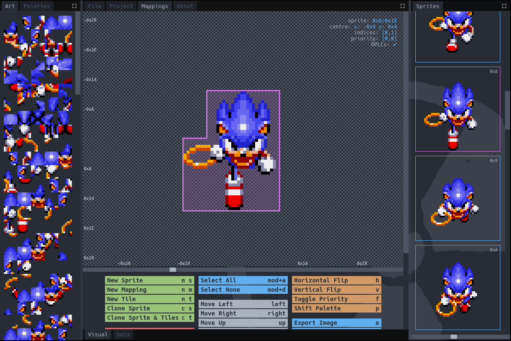

    
     

 

Flex 2 is a sprite editor for the Sega Megadrive

# [download](https://github.com/kirjavascript/Flex2/releases)

[//]: # (__docs__)

## Controls

Most of the keyboard shortcuts (and indeed, behaviours for the application) are listed on the Mappings tab at the bottom. Some commands take a multiplier, so <kbd>32</kbd> + <kbd>Up</kbd> will move the selected mappings 32 pixels up, or <kbd>8</kbd> + <kbd>nt</kbd> will add eight new tiles.

### Inputs

You can cycle through options in dropdown boxes and increase/decrease numbers in textboxes with the mouse scroll wheel. This also works for things like colour select in drawing mode. Up/Down can also be used in textboxes.

### General UI

The UI layout is fully customisable by moving or resizing tabs.

## File Screen

After selecting a game format, individual assets can be saved and loaded. Art based assets can specify an offset to load from (for example, for loading HUD graphics from a VRAM dump). To load every asset at once, use the load/save in the 'Object' line.

The 'label' specified in the mapping and DPLC definitions will be used as the main label in ASM file output.

The file screen is reused for individual objects in projects.

## Project Files

Project files serve as definitions for all the objects in your project. They should sit at the root of your project directory and be committed to version control. Project file configuration is autosaved.

Projects consist of objects, which are definitions of the filepaths used for an object's assets, and folders, which can be used to organise objects into groups.

The filetree style menu on the left of the project screen allows you to drag and drop objects and folders to different places to more easily organise them. Right clicking gives you a menu for various operations for managing objects and folders, and each item can be renamed within the filetree as well as in the object configuration itself.

## Mapping Editor

The mapping editor has the following mouse interactions;

| action | behaviour  |
|---|---|
| drag  | select the pieces fully inside the box, replacing the selection  |
| double click (on a piece) | add the piece to the selection, or remove it |
| drag (on sprite)  | move mapping(s)  |
| right drag | pan viewport |
| wheel | zoom in whole steps from 1x to 20x, around the sprite's origin rather than the cursor; ignored while placing a new piece |

### New Mapping

The new mapping overlay can be toggled with <kbd>nm</kbd>. To add a new mapping piece, drag it from the new mapping overlay to where in the mapping area you want it to display and the new mapping overlay will move out of the way.

The overlay can be configured to autodismiss when placing a piece, or return to allow easily adding multiple pieces.

### Drawing Mode

Press <kbd>m</kbd> to enter drawing mode. The left and right mouse buttons each draw with their own colour, picked from the palette HUD.

Tools: Pencil, Line, Rectangle, Fill, Ellipse and Star, with a brush width (and a point count for Star).

Middle click, or <kbd>Ctrl</kbd>+click, is an eyedropper: it picks up the colour under the cursor into that button's colour, and keeps picking while held.

Drawing changes the art directly, so every piece using a tile shows the change. If mappings overlap, both will have the colour applied.

### Data Tab

The Data tab (previously the raw editor) lets you view and edit the raw values of mappings and DPLCs for the current sprite without any automatic optimisations being applied.

Each mapping piece shows its properties (top, left, tile, width, height, priority, vflip, hflip, palette) and each DPLC entry shows its tile index and length alongside a tile preview. Entries can be reordered by dragging the handle, deleted individually, or added with the buttons at the bottom. DPLCs can also be optimised in bulk.

### Metadata

The Data tab supports arbitrary key-value metadata at two levels;

- **Sprite metadata** — displayed at the top of the Data tab for the current sprite. Use the <kbd>+</kbd> button next to the sprite header to add a new key.
- **Mapping / DPLC metadata** — each mapping or DPLC entry has a collapsible metadata section. Click <kbd>+</kbd> to add a key, and <kbd>×</kbd> to remove one.

Metadata values are preserved through save/load and can be used by custom format scripts.

## Palettes

Palette input will be normalised to Megadrive colours. To change the order of palette lines, you can drag the numbers to different positions.

## Sprites

The Sprites tab gives an overview of your full object's data, allowing you to change sprites or reorder them by dragging and dropping. Every sprite is drawn at the same zoom, set by the slider under the list (1x to 8x).

## Importing

### Importing a spritesheet

Open a spritesheet with **Import Spritesheet** (<kbd>s</kbd>), or drop an image onto the mapping area. Importing has two steps: **detect**, which splits the sheet into sprites, and **import**, which turns each sprite into mappings and art.

#### Detecting sprites

**Detect Sprites** finds each separate sprite and draws a box around it. **Fuzziness** is the gap in pixels that still counts as part of the same sprite; raise it if sprites are being split into pieces. Sprites are read in rows, top to bottom and left to right.

**Fixed Canvas** is for sheets where every frame sits in the same size canvas:

- The sheet must be a single row of square cells. Cell size is the sheet's height, and the number of cells is the width divided by the height. Any strip left over on the right is ignored.
- Each cell becomes one sprite, including empty cells, so sprite numbers match cell positions.
- Each frame is positioned relative to its cell's centre rather than centred on its own pixels, so frames keep the alignment they have in the sheet.
- **Export Spritesheet** (<kbd>E</kbd>) writes sheets in this layout, with each sprite's origin at its cell's centre, so an exported sheet imports back with the same positions.

#### Importing sprites

Each sprite is shown with the mappings that will be made for it. **Import Sprite** imports the current one; **Import All** imports every sprite in order. **Next / Prev Sprite** move between sprites, and **Back** returns to detection.

| Option | Behaviour |
|---|---|
| Reduce Mappings / Reduce Tiles | Whether to prefer fewer mapping pieces or fewer tiles |
| Allow Overlap | Lets pieces overlap; usually fewer pieces and tiles. Off: pieces never overlap |
| Grid Aligned | Keeps all of a frame's pieces on one 8px grid. Off: pieces can be placed at any pixel, which usually saves tiles |
| Reuse More Tiles | Tries cutting the frame on the grid that matches tiles already in the art, so parts repeated across frames come out as identical tiles. Saves tiles, especially with DPLCs, but can add DPLC entries |
| Palette | The palette line the sprite's colours are matched to |
| Zoom | Preview zoom |

**Mappings** and **Tiles** show the current sprite's piece count and the tiles its pieces cover, with how many of those tiles are new to the art. The piece count shows `...` while mappings are being worked out.

#### Behaviour

- Colours are matched to the chosen palette line using CIEDE2000 nearest colour. The palette offset of the art and of the current art bank is applied too.
- New tiles are added to the current art bank.
- Tiles already in the art are reused, including flipped ones, rather than added again. Without DPLCs a piece can only reuse a whole matching run of tiles. With DPLCs, tiles are reused one at a time from anywhere in the art, and DPLC entries are made up to 16 tiles long. Each format merges or splits entries to its own limit when saving.

### Importing over the current frame

**Import Image** (<kbd>i</kbd>) redraws the current sprite's existing tiles from an image, keeping its mappings. The image's top left lines up with the top left of the sprite's pieces; there is no limit on its size, and anything outside the pieces is ignored. Colours are matched to each piece's palette line the same way. The top left pixel is only used as transparency when **Import Image: use top left pixel as alpha** is on in Settings.

## Custom Formats

The base formats are provided in the `scripts/` directory, and serve as examples for custom mapping scripts.

Full (AS-style) macro support is available for assembly files, along with the ability to specify custom output.
